# Privi

[English](./README.md) · [简体中文](./README.zh-CN.md) · [繁體中文（香港）](./README.zh-HK.md)

Personal, on-device **Android media vault**. Hide photos and videos from the
system gallery, rate them with **1–3 hearts**, organize albums and collections,
play with a **VLC-style built-in player** or external **VLC**, back up the vault
on disk, and lock the app with **pattern / PIN + biometric**. Dark theme only.
Sideload-only — media stays local; no cloud storage, accounts, or analytics.

**Author:** [kcng0](https://github.com/kcng0) · **License:** [MIT](./LICENSE) · **Support:** [Buy Me a Coffee](https://buymeacoffee.com/kcng0).

This is a personal project; simplicity is favored over features.

---

## Install (APK)

Privi is not on Google Play. Download a release APK and sideload it:

1. Open the latest **[Release](https://github.com/kcng0/privi/releases/latest)**.
2. Download `privi-<version>.apk` (and optionally `SHA256SUMS`).
3. Verify the download (desktop):
   ```bash
   sha256sum -c SHA256SUMS
   ```
4. On your phone, allow install from your browser/file manager if prompted.
5. Open the APK and install.

Each release includes:

| Asset | Purpose |
|-------|---------|
| `privi-<version>.apk` | Sideload install |
| `SHA256SUMS` / `.sha256` / `CHECKSUMS.txt` | Integrity check |
| **Source code (zip / tar.gz)** | Auto-attached by GitHub for the tag |

**Requirements:** Android 8.0+ (API 26). Optional: [VLC](https://www.videolan.org/)
for external video playback. All media stays on-device.

> Official GitHub Release APKs are **release-signed** with a permanent keystore
> (same signature across versions). First-time installs of a new signature may
> still get a Play Protect “unknown app” prompt until Google has seen the
> binary — use **Install anyway** and leave harmful-app detection enabled.

### Hot updates

Starting with **v1.0.4**, updates are fully user-controlled. Open **Settings →
Check updates** to check the latest stable GitHub Release first, then the
Shorebird hot-update channel for the installed base. A newer full release is
shown with a confirmation action that opens its GitHub Release page. When a
signed Dart patch is available, Privi asks before downloading it. Starting with
v1.0.5, a successful patch download restarts Privi automatically so the patch
is active immediately. The About dialog shows the base version/build and
applied patch number.

Android/native code, plugins, permissions, bundled assets, and Flutter engine
changes still require a new APK. v1.0.3 contained the first updater but used its
automatic mode, so install v1.0.5 once to enable consent-based updates with
automatic restart. Network access occurs only after the manual check; vault
media stays on-device.

---

## Features

- **Visible | Invisible** home — browse system gallery folders or the private vault
- **Remembered mosaic and list layouts** — each home tab, folder, and collection keeps its own view
- **Directory hide** — media removed from the system gallery while kept on disk
- **Consistent HD posters** — the same 768 px video frame before and after Hide
- **Stable date order** — folders keep original capture chronology after Hide
- **Hearts (0–3)**, favorites, rating filters, multi-sort, and manual drag-to-arrange
- **Collections** — create, rename, organize members, and dissolve without deleting media
- **Share** selected Visible or Invisible media through the system chooser, and import images or videos shared into Privi
- **Built-in player** aligned with VLC: previous/next, elapsed and total time, long-press 2×, double-tap and drag seek, timeline frame preview, and left brightness / right volume swipes
- **Display** — Best fit, Fit screen (crop), Fill (stretch), Original size, and fixed ratios. Orientation follows the sensor; a session lock survives media changes
- **Audio and subtitles** — track selection, an external subtitle file, audio/subtitle delay, and A–B repeat on the Android player
- **Picture in picture** for the current Android video. The vault stays locked and playback does not advance
- **External playlists** — VLC and other external players advance only when playback completes. Back stays on the current item
- **Pattern / PIN + biometric** lock, auto-lock, and optional `FLAG_SECURE` (block screenshots)
- **Root resume lock** — covers every tab and route. Only a tracked media-app return skips re-authentication
- **Verified vault backup** — export and restore media plus metadata, with checksum checks
- Languages: system default, English, 简体中文, and 繁體中文（香港）
- On-device media storage; signed update checks are user-triggered

### Keywords / search terms

`android photo vault` · `hide photos from gallery` · `private gallery app` ·
`video vault` · `offline media locker` · `pattern lock gallery` ·
`biometric photo lock` · `sideload apk vault` · `flutter media vault` ·
`hide videos android` · `no cloud gallery` · `vlc private player`

GitHub topics: `flutter` `android` `photo-vault` `video-vault` `private-gallery`
`hide-photos` `biometric-lock` `privacy` `offline` `sideload` `apk` `vlc` `mit-license`

---

## Screenshots

Captured from the current **Privi v1.1.0** Flutter UI using synthetic folders,
albums, collections, and the bundled app icon. No personal media or connected
device is used. The player frame uses the same public controls as the built-in
Android player; the widget test does not start a decoder.

Maintainers can regenerate them without an Android device:
`flutter test tool/readme_screenshots_test.dart --update-goldens`.

| Visible mosaic | Visible list | Invisible mosaic |
|:--------------:|:------------:|:----------------:|
| 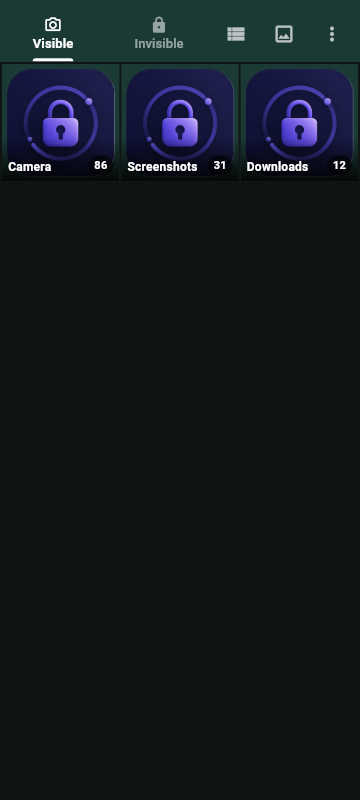 | 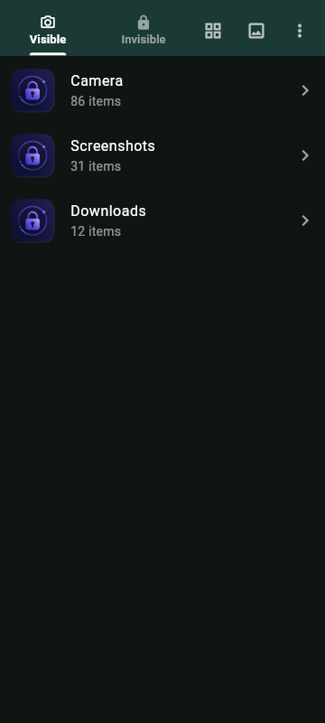 | 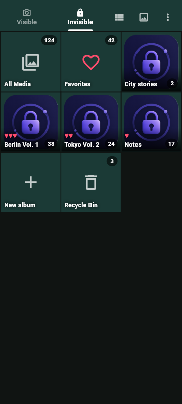 |

| Invisible list | Collection mosaic | Collection list |
|:--------------:|:-----------------:|:---------------:|
| 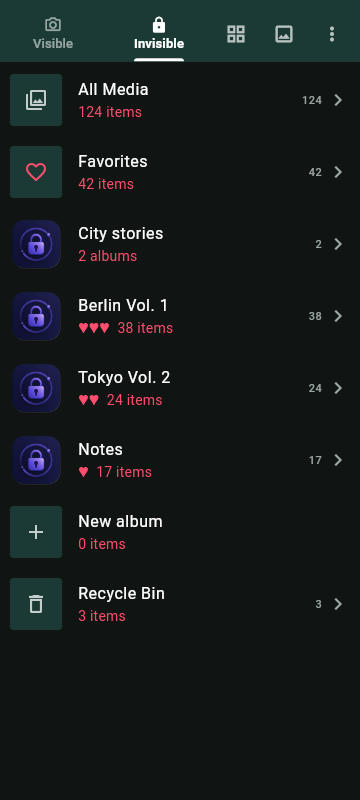 | 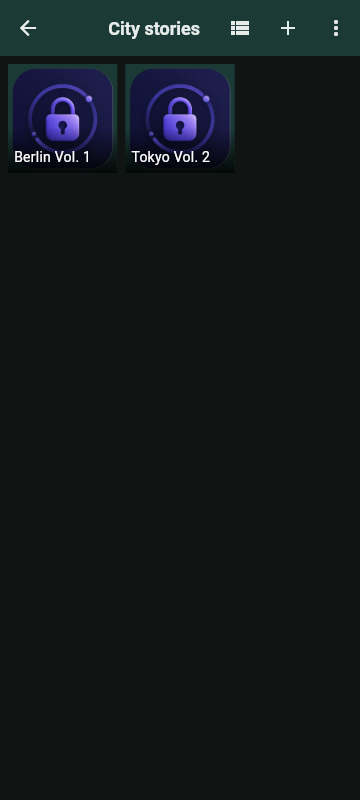 | 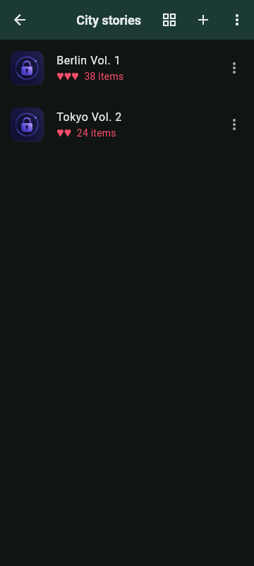 |

| Collection management | Album | Selection |
|:--------------------:|:-----:|:---------:|
| 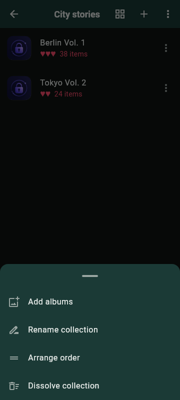 | 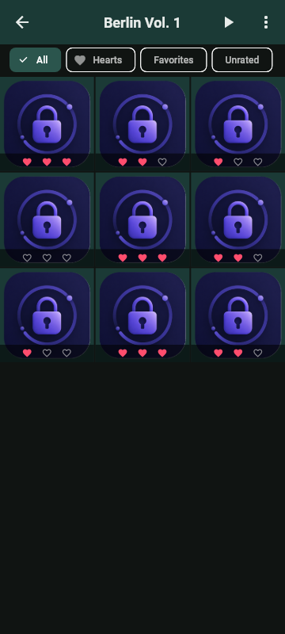 | 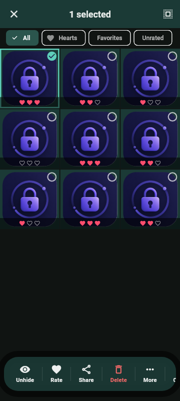 |

| Player | Player settings | Settings |
|:------:|:---------------:|:--------:|
| 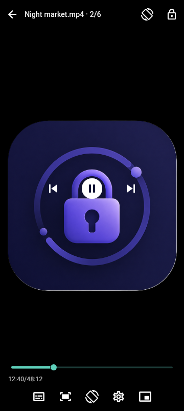 | 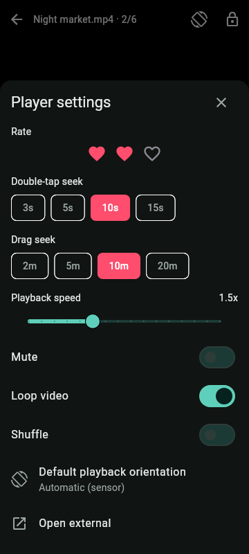 | 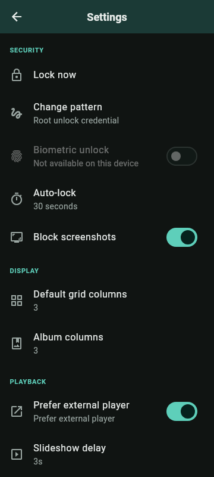 |

| Vault backup | Lock setup |
|:------------:|:----------:|
| 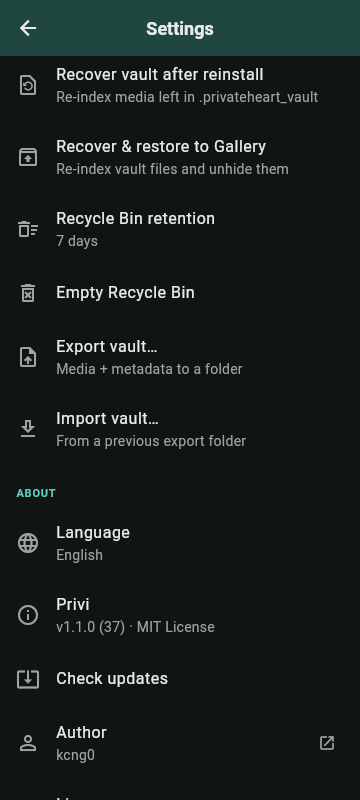 | 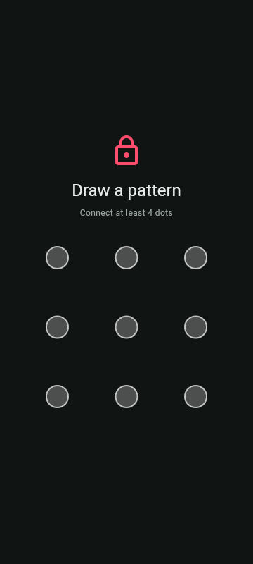 |

- **Visible / Invisible** — tab-specific mosaic and list layouts for folders, albums, and collections.
- **Album** — heart ratings and the rating filter on vault media.
- **Selection** — unhide, rate, share, and delete for the current selection.
- **Player** — elapsed/total time, previous/next, display mode, orientation, tracks, and picture in picture.
- **Player settings** — heart rating, double-tap and drag seek, playback speed, and the default orientation.
- **Settings / backup / lock** — security, playback, verified vault export and restore, and first-run pattern setup.

---

## Develop

### Prerequisites

| Tool | Notes |
|------|--------|
| Flutter **3.44.6** | Prefer [FVM](https://fvm.app/) (`.fvmrc` pins the exact version) |
| JDK 17+ | Android Gradle |
| Android SDK | platform **37**, build-tools, cmdline-tools, licenses accepted |
| Device / emulator | Android 8.0+ (API 26) |

### One-shot setup (Ubuntu / WSL2)

```bash
git clone https://github.com/kcng0/privi.git
cd privi

# Optional: install Flutter + Android SDK + licenses
./scripts/install-toolchain.sh && source ~/.bashrc

# Generate native scaffold (if needed), deps, codegen
./scripts/bootstrap.sh

# Prepare the pinned Android SDK, then run on a connected device
make native-sdk
make run
```

### Everyday commands

```bash
make native-sdk # prepare the pinned SDK before running Android (not needed for iOS)
make run       # launch on a connected device
make test      # unit + widget tests
make analyze   # static analysis
make format    # dart format lib test
make gen       # build_runner (Drift + Riverpod)
make watch     # codegen in watch mode
make apk       # release APK for sideloading
make help      # list targets
```

Without `make`, use `fvm flutter …` (or plain `flutter` if FVM is not installed).

Full environment notes, troubleshooting, and CI details:
**[DEVELOPMENT.md](./DEVELOPMENT.md)**.

### Repository layout

```
├── lib/           # Dart source (feature-first)
├── test/          # unit + widget tests
├── tool/          # README screenshot generator
├── android/       # Android host project
├── ios/           # in-repo iOS host; releases are Android APKs
├── assets/        # branding / icons / screenshots
├── scripts/       # bootstrap + toolchain installer
├── .github/       # CI + release workflows
├── pubspec.yaml
├── Makefile
└── DEVELOPMENT.md
```

---

## Releases & CI

| Workflow | Trigger | What it does |
|----------|---------|--------------|
| [CI](./.github/workflows/ci.yaml) | push / PR to `main` | format, codegen, analyze, test only |
| [Release](./.github/workflows/release.yml) | tag `v*` or manual dispatch | Shorebird base APK + checksums + GitHub Release |
| [Patch](./.github/workflows/patch.yml) | manual dispatch on `main` | signed Dart patch for an existing base release |

To cut a release from a clean `main`:

```bash
# bump version in pubspec.yaml (e.g. 0.1.0+1 → 0.1.1+2), commit, then:
git tag v0.1.1
git push origin v0.1.1
```

Or run **Actions → Release APK → Run workflow**. For Dart-only fixes that do
not require a new APK, merge the change through a PR without bumping the app
version, then run **Actions → Shorebird Patch** with the exact base version
(for example `1.0.4+5`).

---

## Support

If Privi is useful to you, you can support development here:

**[Buy Me a Coffee](https://buymeacoffee.com/kcng0)**

## Community

- **[Linux do](https://linux.do)**

## License

[MIT](./LICENSE) — Copyright (c) 2026 [kcng0](https://github.com/kcng0).
